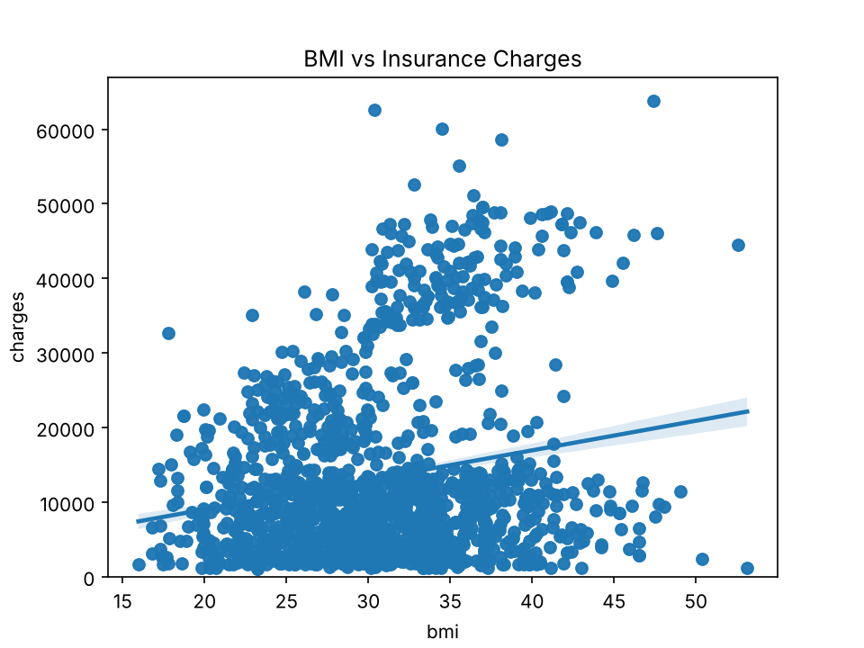
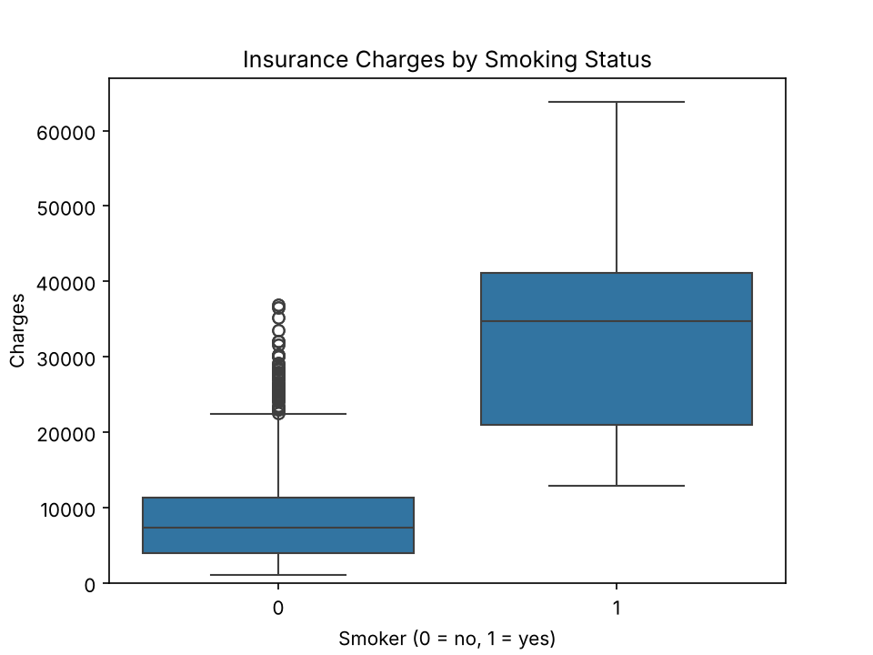
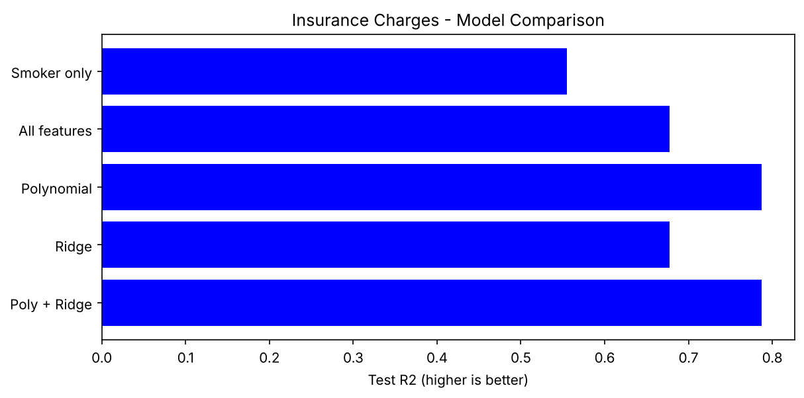

# Medical Insurance Cost Prediction

Predicting a person's medical insurance charges from age, BMI, smoking status and more, using Linear, Polynomial and Ridge Regression in Python.

## About

- **Goal:** Find which factors affect insurance charges the most, and predict charges from them.
- **Data:** 2,772 insurance records from the IBM Data Analyst Professional Certificate. Columns: age, gender, BMI, number of children, smoker, region and charges.
- **Tools:** Python, pandas, NumPy, Matplotlib, Seaborn, scikit-learn

## What I Did

1. Cleaned the data: replaced "?" with missing values, filled 7 missing `smoker` values with the most common value and 4 missing `age` values with the average.
2. Explored how charges relate to BMI, smoking and other columns.
3. Changed `region` into separate yes/no columns, so the model does not treat region 4 as "bigger" than region 1.
4. Split the data into training (80%) and test (20%) sets.
5. Compared 5 models: Linear (smoker only and all features), Polynomial, Ridge and Polynomial Ridge.

## Charts

**1. BMI vs Insurance Charges** : 
Charges tend to rise with BMI, but the points are widely spread. BMI alone is a weak predictor.



**2. Charges by Smoking Status** : 
Smokers pay far more. The median charge is about $34,700 for smokers and $7,300 for non-smokers.



**3. Model Comparison** : 
The Polynomial models have the highest Test R² (0.79).



## Results

| Model | Test R² | Test RMSE |
|---|---|---|
| Linear - smoker only | 0.56 | $7,661 |
| Linear - all features | 0.68 | $6,517 |
| Polynomial + Linear | **0.79** | **$5,293** |
| Ridge | 0.68 | $6,517 |
| Polynomial + Ridge | **0.79** | **$5,293** |

**Best model:** Polynomial Regression, with a Test R² of 0.79 and an average error of about $5,300.
**Key finding:** Smoking status has by far the strongest link with charges (correlation 0.79), followed by age (0.30) and BMI (0.20).

## Limitations

- Small dataset (2,772 rows) from a course, so it may not match real insurance pricing.
- Default model settings were used, with no tuning.
- About 21% of the variation in charges is still unexplained by the best model.

## How to Run

```bash
pip install -r requirements.txt
python medical_insurance_cost_prediction.py
```

Charts are saved in the `images/` folder.

## Credits

Based on an IBM Data Analyst Professional Certificate (Coursera) lab. I added a proper train/test evaluation, RMSE scores, region encoding and saved charts.
